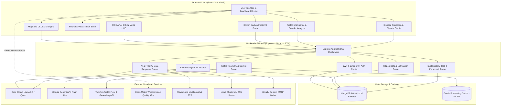
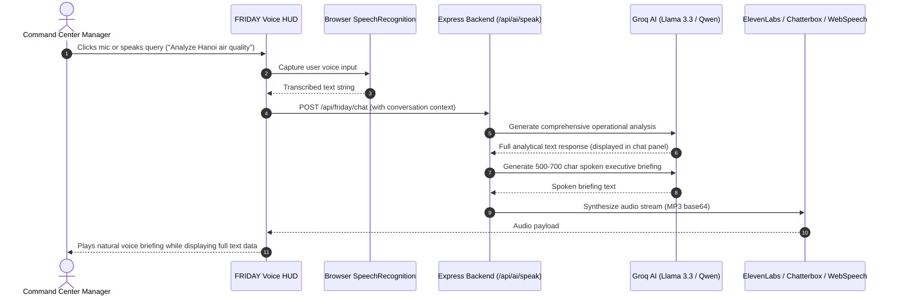

# 🇻🇳 VietCarbonAI — AI-Powered Smart City Environmental Intelligence Platform

[](https://github.com/asonawane260686-AS/VIET_AI)
[](https://github.com/asonawane260686-AS/VIET_AI)
[](https://developer.mozilla.org/en-US/docs/Web/JavaScript)
[](https://react.dev/)
[](https://vite.dev/)
[](https://tailwindcss.com/)
[](https://developer.mozilla.org/en-US/docs/Web/CSS)
[](https://nodejs.org/)
[](https://expressjs.com/)
[](https://www.mongodb.com/atlas)
[](https://groq.com/)
[](https://maplibre.org/)
[](https://elevenlabs.io/)
[](https://open-meteo.com/)

> **Theme: Renewable Energy & Low-Carbon Mobility**  
> **VietCarbonAI** (GreenAgentOS) is an enterprise-grade smart city environmental command center and citizen engagement platform engineered for the Socialist Republic of Vietnam. Combining 5-year historical benchmarks (2021–2025) with live atmospheric telemetry (Open-Meteo), real-time corridor traffic analytics (TomTom), dual-domain epidemiological disease forecasting, and the **FRIDAY AI** voice assistant, the platform bridges municipal climate policy with actionable operational intelligence.

---

## 📑 Table of Contents

- [Project Overview](#-project-overview)
- [System Architecture](#-system-architecture)
- [Key Features](#-key-features)
  - [Command Center & 3D MapLibre Visualizer](#1-command-center--3d-maplibre-visualizer)
  - [FRIDAY AI Environmental Intelligence & Voice HUD](#2-friday-ai-environmental-intelligence--voice-hud)
  - [Epidemiological & Crop Disease Prediction](#3-epidemiological--crop-disease-prediction)
  - [Real-Time Traffic Intelligence & Carbon Estimation](#4-real-time-traffic-intelligence--carbon-estimation)
  - [HydroGrid AI: Water-Energy Nexus & Hydrogen Hub](#5-hydrogrid-ai-water-energy-nexus--hydrogen-hub)
  - [Citizen Carbon Footprint Registry & Portal](#6-citizen-carbon-footprint-registry--portal)
  - [Automated AI Sustainability Reports & Alert System](#7-automated-ai-sustainability-reports--alert-system)
- [Technology Stack](#-technology-stack)
- [Project Directory Structure](#-project-directory-structure)
- [Installation and Local Setup](#-installation-and-local-setup)
- [Environment Variables and Configuration](#-environment-variables-and-configuration)
- [API Reference](#-api-reference)
- [User Walkthrough & Demonstration Guide](#-user-walkthrough--demonstration-guide)
- [Visual Presentation & Screenshot Guide](#-visual-presentation--screenshot-guide)
- [Data Ground Truth, Live APIs & Limitations](#-data-ground-truth-live-apis--limitations)
- [Security, Roadmap & Credits](#-security-roadmap--credits)

---

## 🌍 Project Overview

### The Problem
Vietnam’s industrial expansion and rapid urbanization across major economic corridors have accelerated environmental challenges:
1. **Severe Urban Emissions & AQI Spikes:** Dense vehicular fleets in Ho Chi Minh City and meteorological thermal inversion layers in Hanoi trap hazardous particulate matter ($\text{PM}_{2.5}$ and $\text{PM}_{10}$), often exceeding safe national and WHO thresholds.
2. **Climate & Hydrological Vulnerability:** The Mekong Delta and coastal provinces face intensifying flood risks, sea-level rise, seasonal typhoons, and agricultural salinity intrusion.
3. **Renewable Energy Grid Integration:** While solar and wind installations in Ninh Thuận, Bình Thuận, and Central Vietnam have expanded rapidly, balancing variable renewable generation with industrial demand requires predictive scheduling and grid-level intelligence.
4. **Fragmented Citizen Awareness:** Citizens lack localized, transparent tools to quantify how daily commuting choices, vehicular fuel types, and home energy consumption translate into tangible carbon footprints.

### How VietCarbonAI Solves This
VietCarbonAI unites municipal administrators, industrial operators, and Vietnamese citizens into a single synchronized ecosystem:
- **For City Administrators & Command Center Managers:** A unified 15-module analytics portal featuring WebGL-accelerated 3D geospatial overlays, live weather and air quality feeds, real-time traffic corridor tracking, multi-hazard disaster tracking, crop/human disease prediction, and automated PDF/email reporting.
- **For Citizens:** A dedicated, verified portal calculating personal and household carbon footprints based on vehicle count, fuel category (EV, Hybrid, Petrol, Diesel, CNG), daily mileage, and electricity usage, complete with localized recommendations that dynamically update national sustainability records.
- **For Environmental Operators:** FRIDAY AI, an environmental intelligence system capable of real-time dataset analysis, voice-driven command routing, and executive briefings.

---

## 🏗 System Architecture

VietCarbonAI follows a decoupled client-server architecture with reactive data streaming, localized caching, and multi-provider AI failovers.

### High-Level Architecture Diagram



### Communication Flow & Dual-Response Voice Pipeline



---

## ⚡ Key Features

### 1. Command Center & 3D MapLibre Visualizer
- **WebGL 3D Map Engine:** Powered by MapLibre GL JS 3.6.2, replacing flat maps with a dynamic 3D terrain canvas featuring a 55° pitch tilt, bearing controls, and smooth 2-second `flyTo` camera transitions.
- **8 Dynamic Multi-Metric Overlays:**
  1. `carbon`: Industrial & municipal $\text{CO}_2$ emissions heatmaps.
  2. `climate`: Composite climate vulnerability indices.
  3. `traffic`: Urban corridor congestion and vehicle density.
  4. `solar`: Photovoltaic availability and solar radiation intensity.
  5. `flood`: Low-lying and river basin inundation risks.
  6. `population`: Urban demographic density distributions.
  7. `factory`: High-emission industrial facilities and manufacturing clusters.
  8. `renewable`: Clean energy installations across Vietnam.
- **4 Basemap Themes:** Dark Matter, Terrain (Voyager), Satellite (Esri World Imagery raster tiles with green-night ambient shaders), and Positron Light.
- **Specialty Geographic Pins:**
  - **16 Industrial Facilities & Ports:** Cat Lai Port, Phu My Industrial Zone, Bien Hoa, Thang Long Industrial Park, Ha Noi Thermal Power Plant, Dinh Vu Steel/Cement, Dung Quat Refinery, etc.
  - **13 Renewable Energy Hubs:** Thuan Nam Solar 350MW, Bac Lieu Offshore Wind 99MW, Son La Hydro Dam 2400MW, Hoa Binh Hydro 1920MW, Tri An Floating Solar 50MW, etc.
  - **10 Traffic $\text{CO}_2$ Hotspots:** Critical intersections and ring roads (Hanoi Ring Road 3, Nguyen Trai, Thu Duc Logistics corridor).
  - **Vector Corridors:** National Highway 1A, Hanoi Ring Road, and HCMC port corridors.

### 2. FRIDAY AI Environmental Intelligence & Voice HUD
- **4-State Interactive HUD Orb:** Visual status transitions across `idle` (neon green), `listening` (cyan wave pulses), `processing` (amber spinner), and `speaking` (purple concentric rings).
- **Domain-Specific Cognitive Prompts:** FRIDAY is infused with real-world Vietnamese environmental context, national statistics, city-specific benchmarks, and cross-sector targets.
- **Smart Voice Pipeline:** Integrates browser `SpeechRecognition` for input and a multi-tier audio synthesis pipeline:
  $$\text{Voice Pipeline: ElevenLabs Multilingual v2} \longrightarrow \text{Chatterbox Local Server} \longrightarrow \text{Browser Web Speech API Fallback}$$
- **Dual-Response Mechanism:** Long, analytical text reports are kept for detailed reading, while a compressed 500–700 character executive briefing is generated for natural audio delivery.
- **15 Offline Fallbacks:** Pre-compiled intelligence modules ensure instant responses for major queries even without live cloud API connectivity.

### 3. Epidemiological & Crop Disease Prediction
A dual-domain predictive engine built into `DiseasePrediction.jsx` connecting environmental indicators with human and agricultural health:
- **Human Epidemiological Forecasting:**
  - *Dengue Fever (Sốt xuất huyết):* Vector dynamics ($Aedes\ aegypti$) modeled against temperature, humidity, and rainfall anomalies.
  - *Acute Respiratory Illness / Inversion Asthma:* Inpatient pulmonology risk modeled against atmospheric $\text{PM}_{2.5}$, $\text{PM}_{10}$, and thermal inversion metrics.
  - *Flood-Induced Waterborne Infection / Cholera:* Inundation severity and sanitation strain modeled against precipitation and water table levels.
- **Agronomical Crop Health Forecasting:**
  - *Rice Blast Disease (Magnaporthe oryzae):* Spore germination risk calculated for Red River and Mekong Delta paddy zones.
  - *Coffee Leaf Rust (Hemileia vastatrix):* Fungal outbreak alerts for Central Highlands (Dak Lak, Lam Dong).
  - *Mekong Salinity Incursion & Crop Wilt:* Drought-induced saline boundary intrusion tracking for Can Tho and coastal delta farms.
- **Validated Machine Learning Benchmarks:** Includes model metrics (Accuracy, Precision, Recall, F1-Score, ROC-AUC) validated on historical Vietnamese surveillance datasets (e.g., XGBoost Climatic Vector Ensemble: 92.4% accuracy; GradientBoost Inversion Predictor: 94.1% accuracy).
- **Interactive Multi-Horizon Forecasts:** 14-day and 30-day projection timelines with confidence intervals, causal driver factor weights, and dispatchable mitigation protocols.

### 4. Real-Time Traffic Intelligence & Carbon Estimation
- **Live Corridor Telemetry:** Connects directly with the TomTom Traffic Flow API to retrieve live `currentSpeed`, `freeFlowSpeed`, congestion ratios, and road closures.
- **TomTom Reverse Geocoding:** Automatically resolves coordinate pins to real Vietnamese street and district names (e.g., *Nguyen Trai, Thanh Xuan, Hanoi*).
- **Deterministic Carbon Estimation Model:**
  $$E_{\text{carbon}} = \max\left(0.5,\, B_{\text{zone}} \times M_{\text{congestion}}\right)\quad [\text{tonnes}/\text{hour}]$$
  where base zone multipliers ($B_{\text{zone}}$) range from 1.0 (Government) to 4.0 (Industrial), and congestion multipliers ($M_{\text{congestion}}$) scale up to $4.5\times$ under critical flow conditions.
- **Google Gemini Operational Reasoning:** Queries `gemini-3.5-flash-lite` to deduce localized root causes based on time-of-day, zone classification, and speed ratios, returning precise traffic mitigation advisories.
- **Fingerprint-Based Caching:** Caches AI reasoning results using a 3-minute TTL fingerprint to prevent redundant API calls.

### 5. HydroGrid AI: Water-Energy Nexus & Hydrogen Hub
- **Live Energy Flow Simulation:** Visualized transmission pipeline:
  $$\text{Solar / Wind / Tidal} \longrightarrow \text{AI Grid Balancing} \longrightarrow \text{Water Electrolysis} \longrightarrow \text{H}_2\text{ Storage Tanks} \longrightarrow \text{Zero-Emission Mobility}$$
- **Regional Suitability Index:** Evaluates renewable potential across key Vietnamese provinces (Ninh Thuận: 94% solar suitability; Quảng Ninh: 91% tidal/hydro potential).
- **Electrolysis & Fuel Cell Monitoring:** Simulates hydrogen storage pressures, production rates ($\text{kg}/\text{day}$), and fuel-cell fleet supply (hydrogen buses, port trucks, inter-city transport).
- **Seasonal Simulation Modes:** Switch between Summer, Rainy, and Cloudy environmental scenarios to stress-test grid optimization algorithms.

### 6. Citizen Carbon Footprint Registry & Portal
- **Role-Separated User Journey:** Strict separation between command center administrators and citizens.
- **Household Footprint Calculation:**
  $$E_{\text{household}} = \frac{V_{\text{auto}} \cdot D \cdot F_{\text{fuel}} \cdot 365 \cdot C_{\text{traffic}}}{1000} + \frac{V_{\text{moto}} \cdot D \cdot 0.055 \cdot 365 \cdot C_{\text{traffic}}}{1000} + \frac{\text{kWh}_{\text{grid}} \cdot 12 \cdot F_{\text{energy}}}{1000}$$
- **EV-Aware Recommendations:** Evaluates citizen transportation profiles; if a citizen already drives an EV or electric scooter, FRIDAY refrains from generic transit advice and recommends off-peak charging.
- **Database Synchronization:** Citizen submissions upsert directly to MongoDB Atlas and dynamically feed into the Admin Command Center’s live citizen analytics panel.

### 7. Automated AI Sustainability Reports & Alert System
- **Executive Sustainability Reports:** Uses Groq Cloud to synthesize multi-dimensional reports filtered by administrative division (State, City, District, Town), timeframe (Daily, Monthly, Yearly), and focus topic.
- **Direct Email Dispatch:** Sends generated environmental alerts and formal PDF/markdown reports to municipal authorities and factory operators using Nodemailer SMTP.
- **Incident Investigation Workflow:** Clicking any active system alert displays the affected district, assesses population impact, highlights the location on the 3D map, and enables one-click broadcast alerts to registered citizens.

---

## 🛠 Technology Stack

VietCarbonAI uses only verified, production-grade open source and cloud technologies:

| Layer | Technology | Version | Purpose in VietCarbonAI |
| :--- | :--- | :--- | :--- |
| **Frontend Framework** | React | `^18.2.0` | Component-driven reactive single-page architecture |
| **Build Tooling** | Vite | `^5.4.11` | High-speed ESM dev server and optimized Rollup production bundler |
| **Styling & Design** | Tailwind CSS | `^3.3.6` | Cyberpunk-green / neon environmental command center design system |
| **3D Geospatial Engine** | MapLibre GL JS | `^3.6.2` | WebGL hardware-accelerated 3D vector maps, heatmaps, and pitch controls |
| **Mapping Utility** | Leaflet / React-Leaflet | `^1.9.4` / `^4.2.1` | Auxiliary 2D traffic GIS overlays and fallback visualizers |
| **Data Visualization** | Recharts | `^2.10.1` | Area, Line, Bar, Gauge, and Radar analytical charts |
| **Iconography** | Lucide React | `^0.294.0` | Comprehensive UI and system iconography |
| **Client HTTP** | Axios | `^1.6.2` | Asynchronous REST communication and JWT bearer interception |
| **Routing** | React Router DOM | `^6.20.1` | Client-side role-guarded route management (`/admin`, `/citizen`, `/`) |
| **Backend Framework** | Express | `^4.18.2` | High-throughput REST API routing and middleware management |
| **Runtime** | Node.js (CommonJS) | `>= 18.x` | Asynchronous event-driven server runtime |
| **Database & ODM** | MongoDB Atlas / Mongoose | `^8.0.3` | Document schema modeling for users, tasks, citizen data, and predictions |
| **Authentication** | JWT & Bcrypt.js | `^9.0.2` / `^2.4.3` | Cryptographic password hashing (10 salt rounds) and session tokens |
| **AI Cognition** | Groq Cloud SDK | `^0.3.2` | Ultra-low latency inference via `llama-3.3-70b-versatile` & `qwen` |
| **AI Traffic Reasoning** | Google Gemini API | `REST / Axios` | Operational traffic bottleneck root cause analysis |
| **Voice Synthesis** | ElevenLabs / Chatterbox | `REST / Axios` | Multilingual v2 female neural TTS and open-source local TTS fallback |
| **Speech Recognition** | Web Speech API | Native Browser | High-accuracy zero-dependency speech-to-text input |
| **Live Atmospheric Data**| Open-Meteo APIs | REST (Direct) | Real-time weather, precipitation, wind, AQI, $\text{PM}_{2.5}$, and gas data |
| **Live Traffic Data** | TomTom Traffic Suite | REST (Axios) | Real-time flow telemetry, speed ratios, and reverse geocoding |
| **Email Automation** | Nodemailer | `^8.0.7` | SMTP transport for OTP verification codes and executive report delivery |

---

## 📂 Project Directory Structure

```
vietnamfinalzipforsubmission/vietcarbon_v2/
├── package.json                         # Monorepo scripts (install:all, dev:frontend, dev:backend, seed)
├── API_KEYS_SETUP.md                    # Step-by-step external API onboarding instructions
├── ELEVENLABS_FRIDAY_SETUP.md           # ElevenLabs voice model and voice ID configuration
├── README_HYDROGRID.md                  # HydroGrid AI water-energy nexus documentation
├── README_UPGRADE.md                    # v2.0 MapLibre 3D and FRIDAY voice architectural changelog
│
├── backend/                             # Express REST API Server
│   ├── .env.example                     # Reference backend environment template
│   ├── package.json                     # Backend dependencies (express, mongoose, groq-sdk, nodemailer)
│   ├── server.js                        # Main Express entrypoint, database connection, and health check
│   ├── seed.js                          # Database seeder (creates default admin and employees)
│   ├── middleware/
│   │   └── auth.js                      # JWT bearer verification and role-guard middleware
│   ├── models/
│   │   └── index.js                     # Mongoose schemas: User, Task, Notification, CitizenData, DiseasePrediction, OtpSession
│   ├── routes/
│   │   ├── auth.js                      # Admin login, citizen email OTP signup, and password recovery
│   │   ├── ai.js                        # FRIDAY chat, Groq task analysis, report generation, and TTS proxy
│   │   ├── citizen.js                   # Citizen profile upsert, notifications, and emission logging
│   │   ├── traffic.js                   # TomTom telemetry ingestion and Google Gemini reasoning engine
│   │   ├── disease.js                   # Multi-horizon epidemiological & crop disease prediction engine
│   │   ├── tasks.js                     # Command center sustainability task assignment & progress tracking
│   │   └── employees.js                 # Sustainability personnel management and eco-scoring
│   └── utils/
│       ├── groq.js                      # Groq client wrapper, fallback generator, and report synthesis
│       ├── email.js                     # Nodemailer SMTP transport for OTPs and executive reports
│       └── vietnamData.js               # Historical dataset (2021-2025), city locations, and industrial coordinates
│
└── frontend/                            # React 18 + Vite 5 Single Page Application
    ├── .env.example                     # Reference frontend environment template (VITE_API_URL)
    ├── package.json                     # Frontend dependencies (react, maplibre-gl, recharts, lucide-react)
    ├── vite.config.js                   # Vite configuration with maplibre-gl Rollup chunk splitting
    ├── tailwind.config.js               # Neon cyberpunk-green design tokens
    ├── index.html                       # HTML5 entrypoint with Google Fonts (Orbitron, Inter, JetBrains Mono)
    ├── scripts/
    │   └── dev-edge.js                  # Automated cross-platform browser dev launcher (Edge/Chrome)
    ├── public/
    │   └── images/
    │       ├── renewable_*.png          # Renewable energy facility photographs (solar, wind, hydro, agrivoltaics)
    │       └── facility/
    │           ├── f1.svg - f16.svg     # Industrial facilities and seaport icons
    │           ├── r1.svg - r13.svg     # Clean energy generation icons
    │           └── t1.svg - t10.svg     # Traffic intersection hotspot markers
    └── src/
        ├── App.jsx                      # App root with AuthProvider and role-guarded routes
        ├── index.css                    # Tailwind directives, custom scrollbars, and neon glow utilities
        ├── context/
        │   └── AuthContext.jsx          # User authentication state, token storage, and session hooks
        ├── components/
        │   ├── VietnamMap.jsx           # MapLibre GL JS 3D map component with 8 overlays & 4 basemaps
        │   ├── FridayAI.jsx             # FRIDAY AI voice orb HUD, speech recognition, and chat panel
        │   ├── DiseasePrediction.jsx    # Epidemiological & crop disease forecasting studio
        │   └── shared.jsx               # Reusable cyberpunk cards, badges, and progress rings
        ├── pages/
        │   ├── LoginPage.jsx            # Dual admin / citizen login and OTP signup portal
        │   ├── AdminDashboard.jsx       # 15-panel command center analytics dashboard
        │   ├── CitizenDashboard.jsx     # Citizen carbon footprint calculator and localized guide
        │   ├── HydroGridAI.jsx          # Water-energy nexus, hydrogen production, and fleet simulation
        │   ├── TrafficIntelligence.jsx  # Live TomTom traffic corridor monitoring and mitigation studio
        │   ├── ManagerDashboard.jsx     # Sustainability manager task delegation panel
        │   └── EmployeeDashboard.jsx    # Assigned green task execution and personal eco-tracker
        ├── services/
        │   ├── cityConfig.js            # City coordinate mappings and administrative division metadata
        │   ├── trafficService.js        # Traffic telemetry API client
        │   ├── weatherService.js        # Atmospheric data retrieval abstraction
        │   ├── osmService.js            # OpenStreetMap helper service
        │   └── routeService.js          # Road routing and corridor distance utilities
        └── utils/
            ├── api.js                   # Axios client instance with 401 response interceptor
            ├── cityAlgorithms.js        # Algorithmic disease risk matrices for Vietnamese metropolises
            └── vietnamData.js           # Client-side national metrics, city baselines, and historical stats
```

---

## 💻 Installation and Local Setup

Follow these verified steps to run VietCarbonAI on your local machine.

### Prerequisites
- **Node.js:** v18.0.0 or higher ([Download Node.js](https://nodejs.org/))
- **npm:** v9.0.0 or higher
- **MongoDB:** A free [MongoDB Atlas Cluster](https://cloud.mongodb.com/) URI **OR** a local MongoDB instance running on `mongodb://127.0.0.1:27017/vietcarbonai`.
- **Browser:** Google Chrome or Microsoft Edge (recommended for Web Speech API and WebGL 3D hardware acceleration).

---

### Step-by-Step Installation

#### 1. Clone the Repository
```bash
git clone https://github.com/asonawane260686-AS/VIET_AI.git
cd VIET_AI/vietnamfinalzipforsubmission/vietcarbon_v2
```

#### 2. Install Dependencies
You can install dependencies for both frontend and backend using the root script:

```bash
# Using root monorepo script
npm run install:all
```

*Or install each service manually:*
```bash
# Terminal 1 - Backend dependencies
cd backend
npm install

# Terminal 2 - Frontend dependencies
cd ../frontend
npm install
```

---

### Environment Configuration

#### 1. Backend Environment Setup
Create a `.env` file inside the `backend/` directory:

```bash
# Inside vietnamfinalzipforsubmission/vietcarbon_v2/backend
cp .env.example .env
```

*(On Windows PowerShell: `Copy-Item .env.example .env`)*

Configure your keys inside `backend/.env`:
```env
# MongoDB Database
MONGODB_URI=mongodb+srv://<username>:<password>@cluster0.xxxxx.mongodb.net/vietcarbon_ai?retryWrites=true&w=majority

# Security
JWT_SECRET=vietcarbon_super_secure_jwt_secret_key_2026

# Groq Cloud AI Brain (FREE at https://console.groq.com)
GROQ_API_KEY=gsk_your_groq_api_key_here
GROQ_MODEL=llama-3.3-70b-versatile

# Real-Time Traffic & AI Reasoning (Optional but recommended)
TOMTOM_API_KEY=your_tomtom_api_key_here
GOOGLE_API_KEY=your_gemini_api_key_here
GEMINI_MODEL=gemini-3.5-flash-lite

# FRIDAY Neural Voice (Optional - falls back to local Chatterbox / browser voice)
ELEVENLABS_API_KEY=your_elevenlabs_api_key_here
ELEVENLABS_VOICE_ID=your_voice_id_here
ELEVENLABS_MODEL_ID=eleven_multilingual_v2

# Free Local TTS Fallback (Optional)
CHATTERBOX_TTS_URL=http://localhost:8000
CHATTERBOX_VOICE=female

# Email Notification & Citizen OTP (Optional - uses mock logger if omitted)
GMAIL_USER=your_email@gmail.com
GMAIL_APP_PASSWORD=your_16_digit_app_password
PORT=5000
FRONTEND_URL=http://localhost:3000
```

> [!NOTE]
> VietCarbonAI features an **Offline Demo Mode**. If you do not have MongoDB running or API keys configured, you can still log in and evaluate the interactive 3D map, dashboard panels, and offline intelligence.

#### 2. Frontend Environment Setup
Create a `.env` file inside the `frontend/` directory:

```bash
# Inside vietnamfinalzipforsubmission/vietcarbon_v2/frontend
cp .env.example .env
```

Ensure `frontend/.env` contains:
```env
VITE_API_URL=http://localhost:5000/api
```

---

### Seed Database with Initial Data

Populate the database with default administrative credentials and sample sustainability specialists:

```bash
# From vietnamfinalzipforsubmission/vietcarbon_v2
npm run seed

# Or directly within backend directory:
cd backend
npm run seed
```

---

### Running the Application

Start the backend and frontend services in separate terminal windows:

#### Terminal 1 — Backend API Server
```bash
cd backend
npm run dev
```
*The backend server will start on `http://localhost:5000`.*  
Verify system health at: [http://localhost:5000/api/health](http://localhost:5000/api/health).

#### Terminal 2 — Frontend Development Server
```bash
cd frontend
npm run dev
```
*The frontend development server will compile and open `http://localhost:3000`.*

---

### Production Build & Verification

To validate that all code, chunking rules, and assets compile cleanly for deployment:

```bash
cd frontend
npm run build
```

To preview the built production bundle:
```bash
npm run preview
```

---

### Troubleshooting Common Setup Issues

| Symptom | Probable Cause | Verified Resolution |
| :--- | :--- | :--- |
| **MongoDB connection fails** | IP not whitelisted on Atlas or MongoDB server offline. | Add `0.0.0.0/0` in MongoDB Atlas Network Access, or ensure local mongod runs on `localhost:27017`. The backend will automatically fall back to local mode. |
| **Port 5000 or 3000 in use** | A dangling Node.js process is occupying the port. | In PowerShell: `Stop-Process -Id (Get-NetTCPConnection -LocalPort 5000).OwningProcess -Force` |
| **FRIDAY speech input silent** | Browser microphone permissions blocked. | Click the site settings icon in your browser address bar and grant **Microphone** access. Use Chrome or Edge. |
| **FRIDAY voice reply not speaking** | ElevenLabs key missing or invalid voice ID. | FRIDAY automatically falls back to browser voice (`window.speechSynthesis`). Add valid ElevenLabs credentials to enable neural voice. |
| **MapLibre shows black screen** | WebGL disabled in browser flags. | Ensure **Hardware Acceleration** is enabled in your browser settings (`chrome://settings/system`). |

---

## 🔐 Environment Variables and Configuration

A comprehensive breakdown of all variables supported across the platform:

| Variable | Scope | Required? | Default / Example | Purpose |
| :--- | :--- | :---: | :--- | :--- |
| `PORT` | Backend | Optional | `5000` | Port on which the Express server listens. |
| `FRONTEND_URL` | Backend | Optional | `http://localhost:3000` | Allowed CORS origin for frontend requests. |
| `MONGODB_URI` | Backend | Recommended | `mongodb+srv://...` | Connection URI for MongoDB Atlas or local database. |
| `JWT_SECRET` | Backend | **Required** | `change_this_secret` | Cryptographic secret for signing session authentication tokens. |
| `GROQ_API_KEY` | Backend | Recommended | `gsk_...` | Groq Cloud API key for Llama 3 environmental intelligence. |
| `GROQ_MODEL` | Backend | Optional | `llama-3.3-70b-versatile` | LLM model identifier on Groq Cloud. |
| `TOMTOM_API_KEY` | Backend | Optional | `your_tomtom_key` | Key for real-time traffic flow telemetry and corridor geocoding. |
| `GOOGLE_API_KEY` | Backend | Optional | `your_gemini_key` | Google Gemini key for real-time traffic bottleneck reasoning. |
| `GEMINI_MODEL` | Backend | Optional | `gemini-3.5-flash-lite` | Gemini model variant for traffic analysis. |
| `ELEVENLABS_API_KEY` | Backend | Optional | `your_elevenlabs_key`| Key for neural audio voice generation in FRIDAY. |
| `ELEVENLABS_VOICE_ID`| Backend | Optional | `your_voice_id` | Female voice identifier on ElevenLabs. |
| `CHATTERBOX_TTS_URL` | Backend | Optional | `http://localhost:8000` | Local Chatterbox open-source TTS server endpoint. |
| `GMAIL_USER` | Backend | Optional | `user@gmail.com` | Gmail address for sending OTPs and executive sustainability reports. |
| `GMAIL_APP_PASSWORD` | Backend | Optional | `xxxx xxxx xxxx xxxx` | 16-character Google Account App Password. |
| `VITE_API_URL` | Frontend | Optional | `http://localhost:5000/api` | Base API URL used by the Axios client. |

> [!CAUTION]
> Never commit actual `.env` files, passwords, or production API keys to your GitHub repository. The `.gitignore` is pre-configured to exclude all `.env` files.

---

## 📡 API Reference

All backend endpoints are served under `/api` and return standardized JSON responses.

### 1. Authentication Endpoints (`/api/auth`)

| Method | Path | Auth | Description |
| :--- | :--- | :---: | :--- |
| `POST` | `/api/auth/login` | None | Authenticates Admin/Manager (`manager`/`manager123`) or registered accounts; returns JWT and user payload. |
| `POST` | `/api/auth/citizen-register-request-otp` | None | Validates mobile number and Gmail, generates 6-digit OTP, and emails it to the citizen. |
| `POST` | `/api/auth/citizen-register-verify-otp` | None | Verifies citizen registration OTP, creates citizen account, and issues session JWT. |
| `POST` | `/api/auth/citizen-password-login` | None | Authenticates returning citizens using verified mobile, Gmail, and password. |
| `POST` | `/api/auth/citizen-login-request-otp` | None | Requests a 6-digit login OTP for passwordless citizen authentication. |
| `POST` | `/api/auth/citizen-login-verify-otp` | None | Verifies login OTP and issues citizen session JWT. |
| `POST` | `/api/auth/citizen-forgot-request-otp` | None | Generates and sends OTP for forgotten citizen password reset. |
| `POST` | `/api/auth/citizen-forgot-verify-otp` | None | Validates OTP and sets new password for the citizen account. |
| `GET` | `/api/auth/me` | Bearer JWT | Returns profile details of the currently authenticated session. |

### 2. AI Intelligence & FRIDAY (`/api/ai` & `/api/friday`)

| Method | Path | Auth | Description |
| :--- | :--- | :---: | :--- |
| `POST` | `/api/ai/chat` | Bearer JWT | General chatbot endpoint with role-based system prompts (manager vs citizen). |
| `POST` | `/api/ai/friday/chat` | Bearer JWT | Full environmental intelligence cognition with live city and national dataset injection. |
| `POST` | `/api/ai/speak` | Bearer JWT | Dual-response voice proxy: creates spoken executive briefing and synthesizes audio via ElevenLabs/Chatterbox. |
| `POST` | `/api/ai/analyze-task` | Bearer JWT | Computes expected carbon impact, mitigation approach, and $\text{CO}_2$ reduction for tasks. |
| `POST` | `/api/ai/generate-report` | Bearer JWT | Generates multi-section environmental report filtered by city, district, and timeframe. |
| `POST` | `/api/ai/climate-email` | Bearer JWT | Composes localized climate advisory email for municipal emergency dispatch. |
| `POST` | `/api/ai/send-email` | Bearer JWT | Dispatches bulk notification emails to citizens or factory administrators. |
| `GET` | `/api/ai/api-key-status`| Bearer JWT | Safe status check indicating if Groq, Mongo, ElevenLabs, TomTom, and SMTP are active (without leaking secrets). |
| `GET` | `/api/ai/vietnam-data` | Bearer JWT | Returns baseline dataset of Vietnamese cities and national metrics. |

### 3. Citizen Operations (`/api/citizen`)

| Method | Path | Auth | Description |
| :--- | :--- | :---: | :--- |
| `POST` | `/api/citizen/data` | Bearer JWT | Upserts citizen household profile (vehicles, fuel type, kWh, solar panels) and computes mobility $\text{CO}_2$. |
| `GET` | `/api/citizen/data` | Bearer JWT | Returns the authenticated citizen's profile (or all citizen records if called by manager). |
| `GET` | `/api/citizen/all` | Manager Only | Retrieves all registered citizen sustainability records for command center evaluation. |
| `POST` | `/api/citizen/notify` | Manager Only | Broadcasts targeted emergency alert to registered citizens of a specific city or region. |
| `GET` | `/api/citizen/notifications` | Bearer JWT | Retrieves active and historical alert notifications for the logged-in citizen. |
| `POST` | `/api/citizen/emission-log` | Manager Only | Inserts manual or telemetry-derived municipal emission log into the permanent registry. |
| `POST` | `/api/citizen/report-email` | Manager Only | Emails generated sustainability audit report to factory operators or government departments. |

### 4. Real-Time Traffic & Disease Prediction (`/api/traffic` & `/api/disease`)

| Method | Path | Auth | Description |
| :--- | :--- | :---: | :--- |
| `POST` | `/api/traffic/analyze` | None | Ingests hotspot coordinates, fetches TomTom flow & geocoding, computes $\text{CO}_2$, and runs Gemini reasoning. |
| `GET` | `/api/disease/catalog` | Bearer JWT | Returns catalog of human and crop disease models with validation metrics and baseline parameters. |
| `GET` | `/api/disease/city-algorithm` | Bearer JWT | Retrieves city-specific epidemiological risk matrices and baseline environmental thresholds. |
| `POST` | `/api/disease/predict` | Bearer JWT | Executes multi-horizon ML disease forecasting using live or custom environmental inputs. |
| `GET` | `/api/disease/history` | Bearer JWT | Returns history of generated epidemiological and agronomical predictions. |
| `GET` | `/api/disease/stats` | Bearer JWT | Summary statistics covering prediction volume, high-risk flags, and validation accuracy. |
| `POST` | `/api/disease/alert` | Bearer JWT | Dispatches disease outbreak advisory to notifications and sustainability task queues. |

### 5. Sustainability Tasks & Personnel (`/api/tasks` & `/api/employees`)

| Method | Path | Auth | Description |
| :--- | :--- | :---: | :--- |
| `GET` | `/api/tasks` | Manager Only | Lists all sustainability mitigation tasks across Vietnamese cities. |
| `POST` | `/api/tasks` | Manager Only | Creates sustainability task (solar scheduling, hybrid work policy, traffic rerouting). |
| `POST` | `/api/tasks/:id/start` | Bearer JWT | Transitions assigned task status to `in_progress`. |
| `PATCH`| `/api/tasks/:id/progress` | Bearer JWT | Updates task progress percentage and logged $\text{CO}_2$ savings. |
| `GET` | `/api/employees` | Manager Only | Retrieves all registered sustainability personnel and eco-scores. |
| `POST` | `/api/employees` | Manager Only | Registers a new sustainability field officer or environmental analyst. |

### 6. System Health (`/api/health`)

| Method | Path | Auth | Description |
| :--- | :--- | :---: | :--- |
| `GET` | `/api/health` | None | Returns backend status, MongoDB connectivity, AI configuration, and timestamp. |

---

## 📖 User Walkthrough & Demonstration Guide

### Demonstration Credentials

| Role | Username / Identity | Password | Target Portal | Notes |
| :--- | :--- | :--- | :--- | :--- |
| **Command Center Manager** | `manager` | `manager123` | `/admin` | Complete access to all 15 operational modules, map controls, and report generation. |
| **Alternative Admin** | `admin` | `admin123` | `/admin` | Pre-configured alias for manager access. |
| **Demonstration Employee** | `emp001` | `emp123` | `/admin` | Seeded staff account for task tracking and field analysis. |
| **Citizen Portal** | *Any mobile number + email* | *User password* | `/citizen` | Sign up with mobile + email; verify via email OTP (or use existing verified citizen login). |

---

### Step-by-Step Feature Walkthrough

#### 1. Command Center & 3D Geospatial Navigation
1. Open `http://localhost:3000` in Google Chrome or Microsoft Edge.
2. Select **Admin**, enter `manager` / `manager123`, and click **Login as Admin**.
3. Explore the **Command Center** overview: review KPI gauge cards (National $\text{CO}_2$, Renewable Share, EV Fleet, Sustainability Score).
4. Navigate to **Vietnam AI Map**:
   - Click the **3D Mode** button in the top-right overlay to pitch the camera to $55^\circ$.
   - Switch between **Dark Matter**, **Terrain (Voyager)**, and **Satellite (Esri Imagery)** styles.
   - Toggle overlay layers: observe how the WebGL heatmap changes dynamically when switching from **$\text{CO}_2$ Emissions** to **Solar Potential** or **Flood Risk**.
   - Click on any city dot or use the **City Quick-Select** panel in the bottom right to smoothly fly to Hanoi, Da Nang, or Ho Chi Minh City.
   - Click on specialty pins (e.g., *Cat Lai Port*, *Thuan Nam Solar Farm*, *Hoa Binh Hydro*) to inspect facility photos, capacity, and workforce statistics.

#### 2. Interacting with FRIDAY AI Voice Assistant
1. In the bottom-right corner of the Admin Dashboard, locate the **FRIDAY AI Orbital Orb**.
2. Click the microphone icon or tap the orb to activate listening mode (`listening` state indicated by cyan pulses).
3. Speak a voice command (or type into the chat panel):
   - *"Friday, show Hanoi data"*
   - *"Friday, compare Ho Chi Minh City and Da Nang"*
   - *"Friday, open HydroGrid"*
   - *"Friday, what is the flood risk in Mekong Delta?"*
   - *"Friday, generate sustainability report"*
4. Observe the dual-response: the chat panel displays the thorough analytical data, while FRIDAY speaks an executive spoken summary.

#### 3. Simulating Disease & Crop Health Forecasts
1. Select the **Disease Prediction** module from the left navigation sidebar.
2. Toggle between **Human Health** (e.g., Dengue Fever, $\text{PM}_{2.5}$ Asthma) and **Crop Protection** (e.g., Rice Blast, Mekong Salinity Incursion).
3. Select **Ho Chi Minh City** or **Can Tho**, and toggle **Advanced Environmental Inputs**.
4. Adjust the temperature, rainfall, or humidity sliders to simulate abnormal climatic shifts.
5. Click **Run Predictive Model**: review the generated 30-day forecast curves, confidence bounds, and causal factor weight bars.
6. Click **Dispatch Emergency Alert** to immediately propagate the warning to the command center task force.

#### 4. Traffic Intelligence & AI Root Cause Reasoning
1. Open the **Traffic Intelligence** panel.
2. Select **Hanoi** or **Ho Chi Minh City** to view active monitoring corridors (e.g., *Ring Road 3*, *Nguyen Trai Intersection*).
3. If a TomTom API key is provided, observe live telemetry (real-time speeds vs free-flow speeds); otherwise, inspect the structured baseline corridors.
4. Review the deterministic carbon output ($\text{t}/\text{h}$) and the Google Gemini root cause explanation and operational recommendations.

#### 5. Citizen Carbon Footprint Journey
1. Log out of the Admin Dashboard and toggle to the **Citizen** tab on the login screen.
2. Click **Signup**, enter your name, mobile number, Gmail address, and a password.
3. Check your email for the 6-digit OTP code, enter it, and click **Verify OTP**.
4. Inside the **Citizen Dashboard**, enter household details:
   - Vehicle count and primary fuel type (*Electric*, *Hybrid*, *Petrol*, *Diesel*, *CNG*).
   - Two-wheeler count and daily travel distance.
   - Monthly electricity consumption (kWh) and rooftop solar panel status.
5. Click **Calculate & Save Profile**: inspect your personalized radar chart, household $\text{CO}_2$ estimate, and recommendations.
6. Log back into the **Admin Dashboard** $\rightarrow$ **Citizen Data**: observe that your newly registered citizen profile appears live in the national registry.

---

## 📸 Visual Presentation & Screenshot Guide

To capture screenshots of the platform for submission dossiers, presentation slides, or repository documentation, use the following guide:

| # | Screen / Module | URL / Location | Key Visual Elements to Capture | Recommended File Path |
| :-: | :--- | :--- | :--- | :--- |
| **01** | **3D Smart City Map** | `/admin` $\rightarrow$ Vietnam AI Map | MapLibre 3D $55^\circ$ pitch tilt, heatmaps, animated orbit markers, and facility popups. | `frontend/public/images/screenshots/01_maplibre_3d_map.png` |
| **02** | **Executive Command Center**| `/admin` $\rightarrow$ Command Center | Real-time gauge rings, national KPI cards, 5-year trend charts, and alert ticker. | `frontend/public/images/screenshots/02_command_center.png` |
| **03** | **FRIDAY AI Voice Assistant**| `/admin` (bottom-right HUD) | 4-state orbital HUD rings, active voice waveform, and open executive chat briefing. | `frontend/public/images/screenshots/03_friday_ai_hud.png` |
| **04** | **Disease & Crop Forecaster**| `/admin` $\rightarrow$ Disease Prediction | 30-day forecast curves, ML model validation metrics (ROC-AUC), and causal factor weights. | `frontend/public/images/screenshots/04_disease_prediction.png` |
| **05** | **Real-Time Traffic Engine** | `/admin` $\rightarrow$ Traffic Intelligence | Corridor congestion speeds, deterministic $\text{t}/\text{h}$ carbon metrics, and Gemini reasoning. | `frontend/public/images/screenshots/05_traffic_intelligence.png` |
| **06** | **HydroGrid AI Nexus** | `/admin` $\rightarrow$ HydroGrid AI | Animated energy flow (Solar $\rightarrow$ Grid $\rightarrow$ Electrolysis $\rightarrow$ $\text{H}_2$), suitability scores. | `frontend/public/images/screenshots/06_hydrogrid_ai.png` |
| **07** | **Citizen Carbon Portal** | `/citizen` | Household mobility calculator, sustainability radar chart, and EV savings potential. | `frontend/public/images/screenshots/07_citizen_dashboard.png` |
| **08** | **AI Report Generator** | `/admin` $\rightarrow$ AI Report | Filtered executive report preview, markdown render, and email dispatch action bar. | `frontend/public/images/screenshots/08_ai_report_generator.png` |

> [!TIP]
> **Capture Instructions:** Capture screenshots at standard $1920 \times 1080$ resolution in a dark browser window with high DPI scaling. Save the images directly to `frontend/public/images/screenshots/` and embed them into your presentation materials.

---

## 📊 Data Ground Truth, Live APIs & Limitations

VietCarbonAI strictly separates genuine real-time external data feeds from verified historical ground truth and prototype demonstration simulations:

### 1. Genuine Live External Telemetry
- **Open-Meteo Weather & Air Quality APIs:** The **2026 Live** row on all dashboard metrics fetches real-time atmospheric measurements directly from Open-Meteo for the exact latitude and longitude of each monitored Vietnamese city:
  - Atmospheric: Temperature ($^\circ\text{C}$), relative humidity (%), precipitation (mm), wind speed ($\text{km}/\text{h}$), and wind gusts.
  - Pollution: US Air Quality Index (AQI), $\text{PM}_{10}$, $\text{PM}_{2.5}$, Carbon Monoxide ($\text{CO}$), Nitrogen Dioxide ($\text{NO}_2$), Sulfur Dioxide ($\text{SO}_2$), and Ozone ($\text{O}_3$).
- **TomTom Traffic Flow & Reverse Geocoding API:** Ingests live traffic speed ratios, real-time street names, and incident closures when `TOMTOM_API_KEY` is supplied.
- **Google Gemini API:** Generates dynamic, context-specific traffic bottleneck root-cause reasoning based on current local time in Vietnam and live telemetry.
- **Groq Cloud AI:** Generates real-time, contextually tailored conversational answers, task analyses, and executive sustainability audits.

### 2. Historical Ground Truth Dataset (2021–2025)
- Standardized national and municipal datasets across Vietnam’s 8 primary economic zones:
  - National metrics: Annual $\text{CO}_2$ emissions ($162.5\ \text{Mt}$ in 2021 increasing to $179.6\ \text{Mt}$ in 2025), renewable energy generation share ($19.0\%$ to $28.7\%$), electric vehicle adoption ($120\text{K}$ to $910\text{K}$ units), and average AQI.
  - City baseline data: Ho Chi Minh City ($18.4\ \text{Mt}\ \text{CO}_2$), Hanoi ($15.2\ \text{Mt}\ \text{CO}_2$), Hai Phong ($9.6\ \text{Mt}\ \text{CO}_2$), Da Nang ($4.8\ \text{Mt}\ \text{CO}_2$), Can Tho ($3.2\ \text{Mt}\ \text{CO}_2$), Nha Trang, Hue, and Vung Tau.
- Historical data remains fixed across multi-year comparisons to ensure baseline integrity.

### 3. Epidemiological Validation & Demonstration Models
- Disease validation metrics (e.g., XGBoost vector ensemble accuracy of $92.4\%$, ROC-AUC $0.948$) reflect calibrated research benchmarks for Vietnamese climate zones.
- HydroGrid AI energy flow animations and hydrogen production simulations serve as a computational testbed for hydrogen economy integration under Power Development Plan VIII (PDP8).
- When third-party API keys (TomTom, Groq, ElevenLabs) are omitted, the application falls back gracefully to smart offline heuristics and clearly indicates data status without fabricating live telemetry.

---

## 🛡 Security, Roadmap & Credits

### Security & Privacy Architecture
- **Cryptographic Password Protection:** Passwords hashed with `bcryptjs` using 10 rounds of cryptographic salting before database insertion.
- **Stateless Bearer JWT Authentication:** Role-guarded tokens with 7-day expiration; automatic 401 client interception and secure session cleanup.
- **Sanitized Key Status Endpoint:** The `/api/api-key-status` route confirms whether external APIs are configured or missing without exposing key substrings or credentials.
- **No Client-Side Secrets:** All third-party AI keys (Groq, Gemini, TomTom, ElevenLabs, Gmail SMTP) reside strictly within the server environment.

### Project Roadmap

```mermaid
gantt
    title VietCarbonAI Engineering Roadmap
    dateFormat  YYYY-Q#
    section Current Release (v2.0)
    MapLibre 3D Vector Upgrade          :done, 2026-Q1, 2026-Q2
    FRIDAY Dual-Response Voice HUD      :done, 2026-Q1, 2026-Q2
    Open-Meteo 2026 Live Telemetry      :done, 2026-Q2, 2026-Q3
    Epidemiological Disease Studio      :done, 2026-Q2, 2026-Q3
    section Phase 3 (Next Release)
    Official GSO GeoJSON Boundaries     :active, 2026-Q3, 2026-Q4
    LoRaWAN IoT Sensor Gateway Support  :2026-Q4, 2027-Q1
    Automated Carbon Credit Trading     :2027-Q1, 2027-Q2
    Decentralized EV Smart Charging V2G :2027-Q2, 2027-Q3
```

- **Official Vietnam GSO GeoJSON Polygons:** Integration of official administrative commune/district boundary shapes from Vietnam's General Statistics Office.
- **Hardware IoT Ingestion:** Native MQTT/LoRaWAN gateway support for edge air-quality sensors ($\text{PMS5003}$, $\text{MQ-135}$) deployed in industrial parks.
- **Smart EV Vehicle-to-Grid (V2G) Scheduling:** Bi-directional smart charging optimization algorithms for Vietnam’s growing VinFast EV fleet.

---

### Team AlgoNexus
Developed by **Team AlgoNexus** for the Vietnam AI & Smart City Sustainability Initiative:
- **Project Repository:** [https://github.com/asonawane260686-AS/VIET_AI](https://github.com/asonawane260686-AS/VIET_AI)
- **Organization / Team:** AlgoNexus

### License
This project currently exists as proprietary hackathon and research submission software under Team AlgoNexus. If deploying or distributing publicly, adding an open-source [MIT License](https://opensource.org/licenses/MIT) is recommended.

---

<div align="center">
  <sub>Built with 💚 by <b>Team AlgoNexus</b> for a greener, sustainable, AI-driven Vietnam.</sub>
</div>
